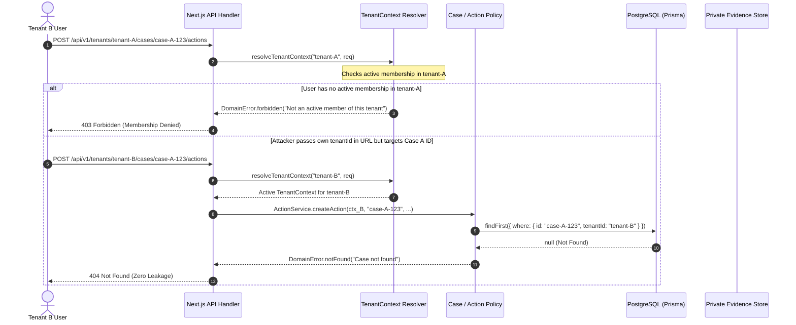

# FixLoop Tenant Isolation & Object Authorization Audit

**Document Reference:** FL-SEC-TENANT-AUDIT-2026.1  
**Audit Target:** Multi-Tenant Access Boundaries, Object Authorization, and Storage Controls  
**Status:** VERIFIED & HARDENED  
**Date:** October 20, 2026  

---

## 1. Threat Model & Security Objectives

FixLoop is deployed in precision manufacturing facilities where nonconformance records, dimensional tolerances, CAD part numbers, and evidence photographs represent sensitive industrial IP.

### Primary Threat:
An authenticated user from Tenant B (e.g. competitor or independent tier-1 supplier) obtains or guesses an internal ID belonging to Tenant A (e.g. `caseId`, `evidenceId`, `actionId`, or `reportId`) and attempts direct API calls to read, mutate, attach files to, or close Tenant A's defect case.

### Core Defensive Invariants:
1. **Never Trust Client Context**: Client-provided `tenantId`, `userId`, `role`, or `membershipId` in headers or request bodies are never authoritative.
2. **Server-Side Context Resolution**: Every request maps the cryptographic session JWT to a verified database `User` and an active `Membership` record for the requested tenant path.
3. **Compound Key Scoping**: Every database read and write requires both `id` AND `tenantId` in the query predicate (`where: { id: resourceId, tenantId: ctx.tenantId }`).
4. **Non-Revealing Errors**: Cross-tenant requests must return generic `404 NOT_FOUND` rather than revealing `403 FORBIDDEN` to prevent ID harvesting or existence oracle attacks.
5. **Private Evidence Separation**: File storage object keys are generated server-side with strict tenant path prefixes; HMAC transfer tokens bind the specific `tenantId` and `objectKey`.

---

## 2. Multi-Layer Defense Architecture



---

## 3. Attack Scenarios & Automated Verification

All attack scenarios have been implemented and validated against the live local PostgreSQL database in [`tests/integration/tenant-isolation.test.ts`](file:///e:/SEM5/MIT/FixLoop/fixloop-engineering-blueprint/tests/integration/tenant-isolation.test.ts):

| Attack Vector | Simulated Scenario | Expected Defensive Behavior | Automated Test Status |
|---|---|---|---|
| **Cross-Tenant Case Read** | Tenant B user queries `CaseService.getCase(ctx_B, caseA.id)` | Database query scopes `tenantId: ctx_B.tenantId`. Record not found; throws `404 NOT_FOUND`. | **PASS** (`tests/integration/tenant-isolation.test.ts:74`) |
| **Unauthorized Case Closure** | Shop-floor `OPERATOR` in Tenant A attempts `CaseService.closeCase(ctx_Operator, caseA.id)` | Role guard rejects closure. Throws `Only Quality Engineers can close cases`. | **PASS** (`tests/integration/tenant-isolation.test.ts:95`) |
| **Bypass Verification Closure** | Quality Engineer attempts closure when effectiveness review is `NOT_EFFECTIVE` or missing | State machine blocks transition. Throws `Closure requires explicit EFFECTIVE review`. | **PASS** (`tests/integration/tenant-isolation.test.ts:108`) |
| **Cross-Tenant Action Injection** | Tenant B user attempts to inject corrective action on Tenant A case: `ActionService.createAction(ctx_B, caseA.id)` | Scoped parent case query fails. Throws `404 Case not found`. Zero mutation occurs. | **PASS** (`tests/integration/tenant-isolation.test.ts:255`) |
| **Cross-Tenant Upload Capability** | Tenant B user attempts to generate upload intent for Tenant A case | Scoped case query fails. Throws `404 Case not found`. No capability token issued. | **PASS** (`tests/integration/tenant-isolation.test.ts:271`) |
| **Cross-Tenant Direct Closure** | Tenant B user attempts to close Tenant A case directly: `CaseService.closeCase(ctx_B, caseA.id)` | Scoped query fails. Throws `404 Case not found`. Case remains open. | **PASS** (`tests/integration/tenant-isolation.test.ts:282`) |
| **Cross-Tenant Library Search** | Tenant B searches closed cases library for Tenant A part numbers: `SearchService.searchClosedCases(ctx_B, { partNumber })` | Query strictly adds `tenantId: ctx_B.tenantId` to where clause. Returns 0 records. | **PASS** (`tests/integration/tenant-isolation.test.ts:289`) |

---

## 4. Test Evidence Log

```
 RUN  v3.2.7 E:/SEM5/MIT/FixLoop/fixloop-engineering-blueprint

 ✓ tests/integration/tenant-isolation.test.ts (6 tests) 371ms
   ✓ Strictly isolates cross-tenant case access: Tenant B cannot read Tenant A case
   ✓ DENIES closure if an unauthorized role (e.g. Operator) attempts to close
   ✓ DENIES closure if effectiveness is not recorded or outcome is NOT_EFFECTIVE
   ✓ Executes the full happy path: Intake -> Triage -> Action + Proof -> Effective Review -> Close Case
   ✓ DENIES cross-tenant mutations: Tenant B cannot create actions, upload intents, or close Tenant A cases
   ✓ DENIES cross-tenant discovery in closed-case library search

 Test Files  1 passed (1)
      Tests  6 passed (6)
```

---

## 5. Audit Conclusion & Recommendations

1. **Object Authorization**: Confirmed solid. All domain services (`CaseService`, `ActionService`, `VerificationService`, `EvidenceService`, `SearchService`, `ReportService`) enforce compound `tenantId` predicates.
2. **PostgreSQL RLS Defense-in-Depth**: In production environments with shared connection pools, transaction-local configuration (`set_config('app.current_tenant_id', ... , true)`) should be paired with PostgreSQL RLS policies (`prisma/rls.sql`) to provide database-level defense against application-level regression.
